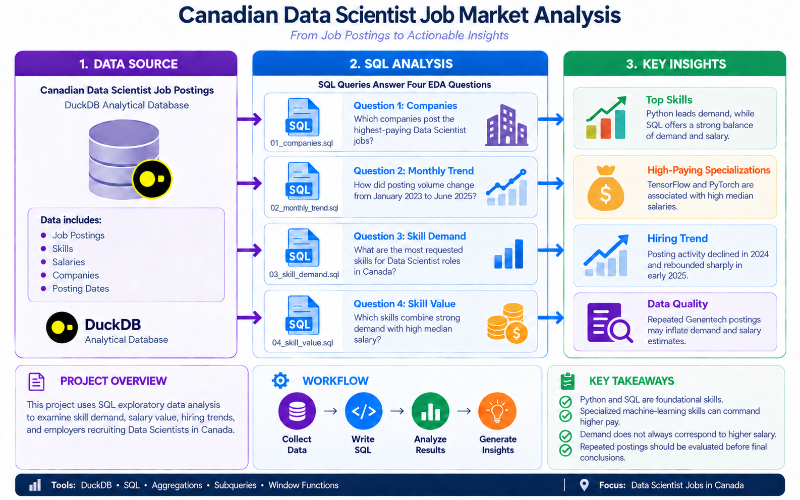
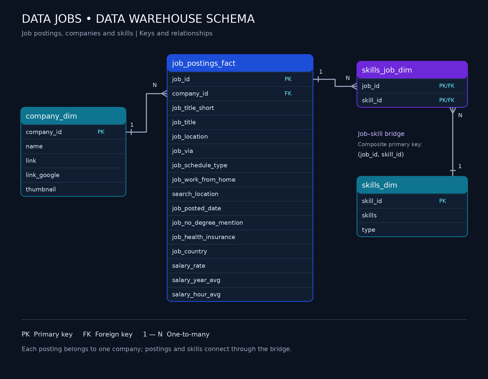

# BASIC EDA - Exploratory Data Analysis
## Canadian Job Postings


A SQL-based data engineering and exploratory data analysis project examining hiring trends, in-demand skills, salary patterns, and top employers for Data Scientist roles in Canada.

## Executive Summary

### 🎯 Introduction

This project uses SQL-based data engineering and exploratory data analysis to examine the Canadian Data Scientist job market and translate job-posting data into actionable insights.

### 📌 Project Scope

The analysis evaluates employer activity, monthly hiring trends, in-demand skills, salary patterns, and skills that offer the strongest combination of demand and compensation.

### 🗄️ Data Modelling

A star-schema structure organizes job postings in a fact table and connects them to company and skill dimensions through primary and foreign keys. A bridge table supports the many-to-many relationship between jobs and skills.

### 🔍 Analysis

DuckDB and SQL were used to join tables, aggregate records, calculate median salaries, compare monthly activity, rank skills and companies, and investigate potential data-quality issues.

### 📈 Outcomes

Python emerged as the most requested skill, while SQL provided a strong balance of demand and salary. Specialized machine-learning skills were associated with higher median salaries. The analysis also identified repeated postings that could inflate hiring, skill-demand, and salary estimates.

If you have a minute, review:
 1. [`01_Companies.sql`](../1_Basic_EDA/01_Companies.sql) - Inner SQL joins company_dim and job_postings_fact to generate the company data.
 2. [`02_Monthly_Trend.sql`](../1_Basic_EDA/02_Monthly_Trend.sql) - The SQL code used to generate the monthly trend and CTE to calulate the percenatge change in montly postings.
 3. [`03_Skill_Demand.sql`](../1_Basic_EDA/03_Skill_Demand.sql) -  Generate the skill demand data using multiple SQL joins.
 4. [`04_Skill_Value.sql`](../1_Basic_EDA/04_Skill_Value.sql) -  SQL code used to generate the skill value data comparing the demand and salary of skills.

 ## Problem and Context

The Canadian Data Scientist job market changes across employers, time periods, skill requirements, and salary levels. This project addresses four questions:

- 🏢 **Companies:** Which employers offer the highest salaries?
- 📅 **Monthly Trend:** How does hiring activity change over time?
- 🛠️ **Skill Demand:** Which skills are requested most frequently?
- 💰 **Skill Value:** Which skills combine strong demand with high median salaries?

### Data Warehouse

This project was analyzed using a data warehouse built with a star-schema design. The warehouse consists of the following components:



The data warehouse uses a **star schema** to support efficient job-market analysis.

- 📊 **Fact Table:** `job_postings_fact` stores job postings, salaries, dates and locations.
- 🗂️ **Dimension Tables:** `company_dim` and `skills_dim` store descriptive company and skill information.
- 🔗 **Bridge Table:** `skills_job_dim` resolves the many-to-many relationship between job postings and skills.

## 🛠️ Tech Stack

- 🦆 **DuckDB:** Analytical database and data storage
- 🗃️ **SQL:** Data transformation, querying and analysis
- 🧩 **Data Modelling:** Star schema with fact, dimension and bridge tables
- 💻 **Development:** VS Code and DuckDB CLI
- 🔀 **Git and GitHub:** Version control, documentation and project hosting

## 📁 Repository Structure

```text
1_Basic_EDA/
├── 01_companies.sql
├── 02_monthly_trend.sql
├── 03_skill_demand.sql
├── 04_skill_value.sql
└── README.md
```

- 🏢 **01_companies.sql:** Identifies companies posting high-paying Data Scientist roles.
- 📅 **02_monthly_trend.sql:** Analyzes monthly job-posting trends.
- 🛠️ **03_skill_demand.sql:** Identifies the most requested skills.
- 💰 **04_skill_value.sql:** Compares skill demand with median salary.
- 📘 **README.md:** Documents the analysis, methodology and findings.

## 📊 Data Analysis Overview

### 🧠 Query Design

1. **[Top Hiring companies](01_Companies.sql)** - Identifies the companies posting with the highest salaries for Data Scientist roles.
2. **[Monthly posting activity](02_Monthly_Trend.sql)** - Analyzes monthly job-posting trends.
3. **[Top skills Demand](03_Skill_Demand.sql)** - Identifies the most requested skills.
4. **[High paying skills](04_Skill_Value.sql)** - Compares skill demand with median salary.


### 🔑 Key Takeaways

- 🐍 **Python and SQL are the most important foundational skills** for Data Scientist roles in Canada.
- 💰 **SQL provides a strong balance between demand and median salary.**
- 🤖 **TensorFlow and PyTorch are associated with higher-paying specialized roles.**
- 📈 **Job postings declined in 2024 but increased sharply in early 2025.**
- 🏢 **Repeated company postings may inflate hiring, skill-demand and salary estimates.**
- 🧹 **Data validation is essential before drawing final conclusions from job-posting data.**

## 💻 SQL SKILs Demonstrated

### 🧩 Query Design and Optimization

Developed structured SQL queries using joins, subqueries, aggregations, filtering, grouping, sorting and limits to retrieve accurate results efficiently.

### 📊 Data Analysis Techniques

Applied ranking, median salary calculations, month-over-month comparisons, trend analysis and data-quality checks to identify skill demand, salary patterns and repeated postings.