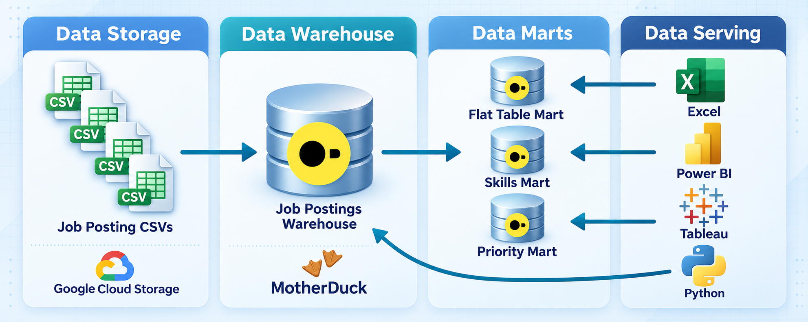
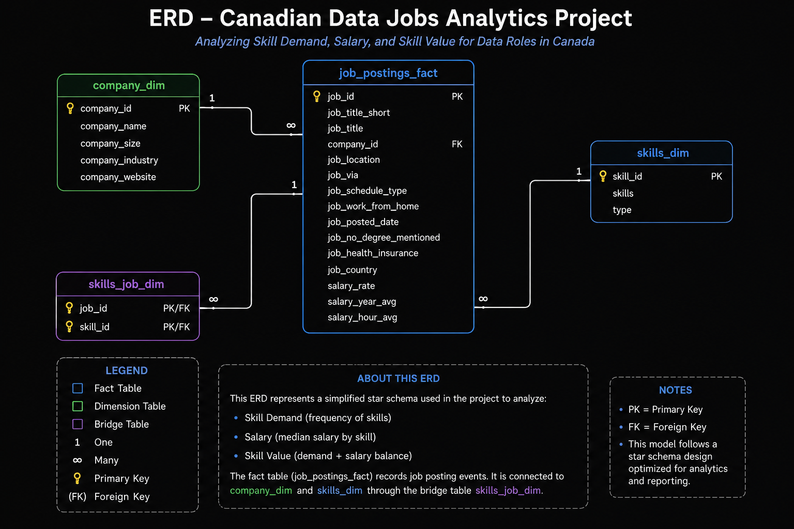
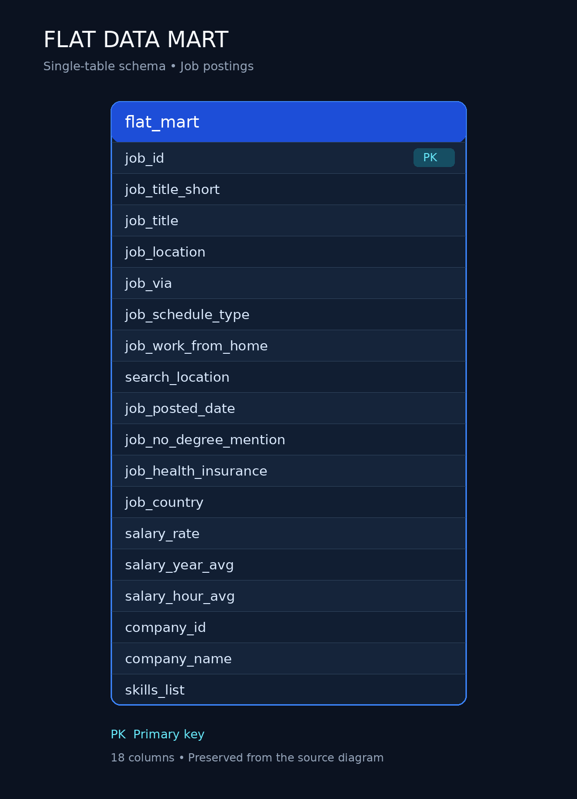
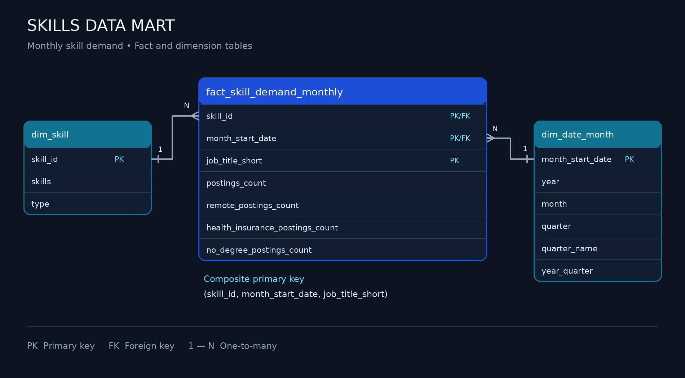
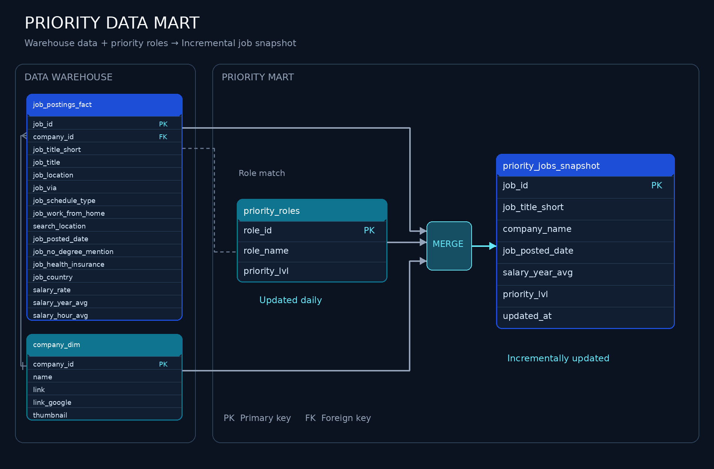

# Data Jobs Warehouse Engineering: ETL Pipeline and Data Mart Implementation
A Data Engineering project pipeline for Data Jobs Warehouse that transforms raw data(CSV files from Google Cloud Storage) into a denormalized star schema data warehouse. From which a data mart is created for data analytics and reporting.

## Executive Summary
- **Pipeline Overview:** Built a **ETL pipeline** from raw CSV files into a **denormalized star schema data warehouse** and anlytical marts using **DuckDB** and **DuckDB CLI**.
- **Data modeling:** Created a **star schema** data warehouse with **fact and dimension tables**, including bridge tables for many-to-many relationships.
- **ETL Process:** Implemented **extraction, transformation, and loading** with **idempotent loads** and **data validation**.
- **Mart Architecture:** Built specialized data marts for **flat reporting**, **skills analysis**, and **priority roles**, with incremental updates to support data analytics and reporting.

## Problem & Context
**Challenge:** Data analysts need a single source of truth to support consistent and reliable analysis across the company. Specialized data marts simplify access to relevant data and, where appropriate, pre-aggregate it to reduce repeated processing and improve query performance.

**Solution:** An end-to-end ETL process that transforms raw data into a denormalized star schema data warehouse and creates various specialized data marts optimized for specific use cases.

##  Tech Stack

- **Database:** DuckDB(file-based OLAP database with GCS integration via httpfs)
- **Language:** SQL(DDL for schema design, DML for data loading and transformation)
- **Data Modeling:** Star schema(fact and dimension tables, bridge tables for many-to-many relationships)
- **Deployment:** VSCode for SQL editing + Terminal for DuckDB CLI execution
- **Automation:** Master SQL script for ETL process orchestration
- **Version Control:** Git/GitHub for versioned pipeline scripts
- **Storage:** Google Cloud Storage(GCS) for source raw CSV files

## Data pipelines Architecture

The **data pipeline architecture** is illustrated through a **data flow diagram** that shows how data moves from raw CSV files into a **denormalized star schema data warehouse** and **specialized data marts.** BI tools such as **Excel, Tableau, and Power BI,** along with **Python** for data analysis, can access data from both the warehouse and the data marts.

### Data warehouse
The **data warehouse** uses a **star schema** that organizes data warehouse with fact table  (`job_postings_fact`) and dimension tables (`company_dim, skills_dim`). A bridge table (`skills_job_dim`) connects job postings to skills, supporting their many-to-many relationship.

- **SQL Files:**
  - [`01_Create_tables_dw.sql`](../01_Create_tables_dw.sql) - Defines star schema with 4 tables
  - [`02_load_schema_dw.sql`](../02_load_schema_dw.sql) -
  - **Purpose:** The Star Schema serves as a single source of truth for data analysis and reporting.
  - **Grain:** One row per job posting in the `job_postings_fact` table.

### Flat data mart
The **flat data mart** is a denormalized table with all dimensions for ad-hoc querries.

- **SQL Files:**
- [`03_create_flat_mart.sql`](../03_create_flat_mart.sql)
- **Purpose:** One row per job posting with all dimensions joined
- **Grain:** One row per job posting with all dimensions joined

### Skills data mart

The **skills data mart** supports **time-series analysis of skill demand,** using additive measures to track trends over time.

- **SQL Files:**
- [`04_create_skills_mart.sql`](../04_create_skills_mart.sql) - Time-series skills demand
- **Purpose:** Time-series skills analysis over time with additive measures
- **Grain:** `skill_id` + `month_start_date` + `job_title_short`
- **Key Features:** Stores **counts and sums** that can be re-aggregated across non-overlapping groups without double-counting.

### Priority roles data mart

The **priority roles data mart** tracks selected job roles, with incremental updates using **MERGE operations**.

 **SQL Files:**
 - [`05_create_priority_mart.sql`](../05_create_priority_mart.sql) - Initial build of the priority roles and jobs snapshot tables
 - [`06_update_priority_mart.sql`](../06_update_priority_mart.sql) - **Incremental update using MERGE** of the priority roles and jobs snapshot tables
 - **Purpose:** Tracks selected job roles with incremental updates
 - **Grain:** One row per job posting with priority level assignment
 - **Key Features:** **MERGE operations** for incremental updates - demonstrates production-ready upsert patterns(INSERT, UPDATE, DELETE in single statement)

## Data Engineering SKILLS Demonstrated

### ETLPipeline Process
- **Extract:** Loading directly from Google Cloud Storage(GCS) using DuckDB's httpfs extension
- **Transform:** Data normalization, type conversion(CAST, DATE_TRUNC), and quality filtering
- **Load:** Idempotent table creation with DROP TABLE IF EXISTS patterns
- **Incremental Updates:** MERGE operations for upsert patterns (INSERT, UPDATE, DELETE in single statement)
- **Orchestration:** Master SQL script(build_dw_marts.sql) for ETL process orchestration

### Dimensional Modeling

- **Star Schema Design:** Fact table `job_postings_fact` and dimension tables `company_dim, skills_dim`
- **Bridge Tables:** `skills_job_dim` for many-to-many relationships
- **Grain Definition:** Proper fact table granularity (skill+month, company+title+location+month)
- **Additive Measures:** Counts and sums that can be re-aggregated at any level
- **Suroagte Keys:** Sequential ID generation using CTEs with self-joins(optional company_mart build only)

### SQL Advanced Techniques

- **DDL Operations:** `CREATE TABLE`, `DROP TABLE`, `CREATE SCHEMA` for schema management
- **DML Operations:** `INSERT INTO...SELECT` with explicit column mapping from CSV sources
- **MERGE Operations:** `MERGE INTO` for incremental updates with `WHEN MATCHED` and `WHEN NOT MATCHED BY SOURCE` clauses for production-ready upsert patterns
- **CTEs:** Common Table Expressions for complex transformations and boolean flag conversions
- **Date Functions:** `DATE_TRUNC('month')`, `EXTRACT(quarter)` for temporal dimension creation
- **String Functions:** `STRING_AGG()` for concatenating, REPLACE() for data cleaning
- **Boolean Logic:** `CASE WHEN` for boolean flag conversions for aggregating (remote, health, no_degree)

### Data Quality & Production Practices

- **Idempotency:** All scripts safely rerunnable without side effects
- **Data Validation:** Verification queries at each step of the ETL process to ensure data integrity
- **Type Safety:** Proper data type definitions (VARCHAR, INTEGER, DOUBLE, BOOLEAN, TIMESTAMP)
- **Schema Organization:** Seperate Schemas (flat_mart, skills_mart, priority_mart, company_mart) for logical separation
- **Error Handling:** Structured script execution with clear error messages and progress tracking reporting

